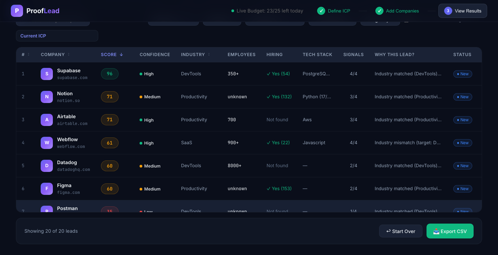
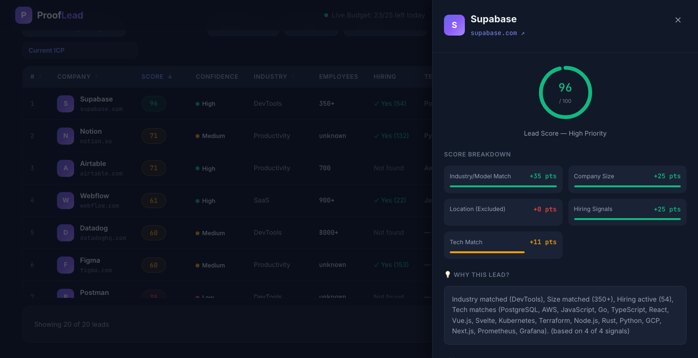
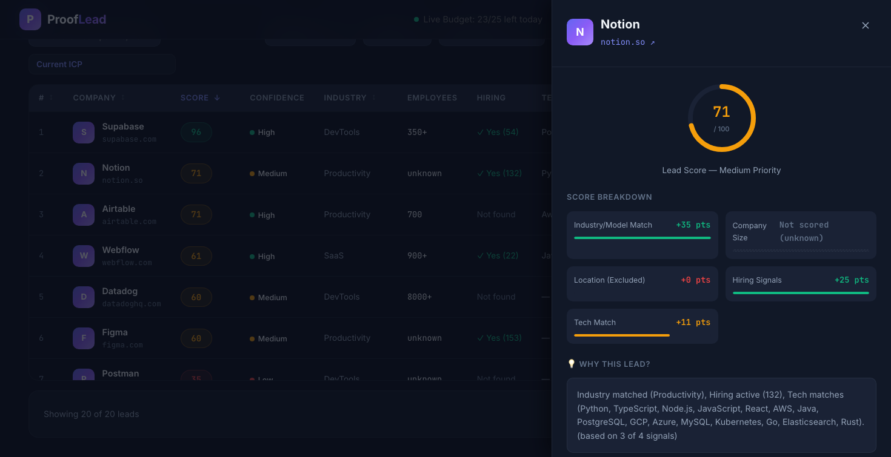
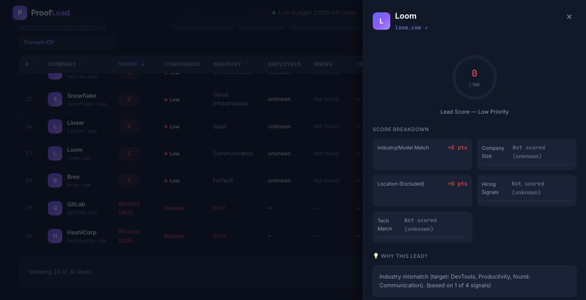

# ProofLead

**Live Demo:** https://prooflead.onrender.com

ProofLead is an evidence-backed lead qualification and ICP scoring platform built for Private Equity (PE) and M&A searchers. It extracts verified hiring and technology signals directly from public company websites and Applicant Tracking Systems (ATS) to identify growth and acquisition readiness.

---

## Reference App Analysis (SaaSquatch)

SaaSquatch is Caprae's lead-generation platform for entrepreneurs and searchers. Its public feature set covers company discovery (by country, city, industry), employee count and revenue estimates, owner information, contact enrichment, AI company scoring, filters, CSV/Excel export, AI email generation, and validators.

- **Strength:** It discovers a high volume of leads rapidly across broad verticals.
- **The Gap ProofLead Targets:** A long lead list does not tell a user which leads to trust or contact first, and an unanchored AI score gives no way to check where a value came from.
- **What ProofLead Builds (Quality First):** ProofLead takes a list of companies you already have and qualifies it. Every enriched field carries the exact evidence it came from, and any field that cannot be verified stays unknown instead of being guessed. It then scores each company against the user's ICP and explains the score.
- **What ProofLead Does Not Do (By Design):** It does not discover new leads, and it does not return contact details or revenue estimates. It complements a discovery tool rather than replacing it.

---

## UX Design Choices

- **Three-Step Flow:** Define ICP, Add Companies, View Results. Users always know where they are in the qualification process.
- **Evidence Panel:** Clicking a lead opens a drawer with each field, its source (website page, page title/meta, ATS, or CSV) and the supporting quote. This is how a user verifies a lead without leaving the app.
- **Honest Empty States:** "Not found" (no detectable job board) is shown differently from "Not hiring" (job board found, zero roles). Unknown stays unknown.
- **Signal Count:** Each score shows how many signals it is based on (for example 3 of 4), so a score built on little data is visible as such. The denominator changes with the ICP (location counts only if the user set one).
- **Confidence and Filters:** Filter by score, status, industry, confidence, and hiring, and hide leads with missing data.
- **Live Budget Indicator:** The header displays real-time live enrichments remaining today.
- **Workflow Fit:** CSV in, CSV out, with evidence and the suggested outreach angle included in the export.
- **Sample Dataset:** One click loads cached companies so the tool can be tried without spending any budget.

---

## Performance, Caching and Reliability

- **SQLite Cache (`leads.db`):** One record per domain. A cached domain is returned immediately with no website fetch and no LLM call.
- **Cost Control:** A daily cap (`DAILY_LIVE_CAP`) and a per-IP cap (`PER_IP_LIVE_CAP`). The counter lives in a small `daily_stats` table and only increases when a live enrichment completes successfully with enough page text.
- **Resilience:** Automatic retry with backoff when a site returns HTTP 429, a clear "blocked" status when retries fail, and `robots.txt` is respected.
- **Data Quality:** LLM quotes are checked against the fetched page text (including `<title>` and meta description taken from the raw HTML). Script, style, and hidden elements are removed before text extraction.
- **Tech-Stack Accuracy:** Technologies are counted at most once per role, using word-boundary matching and an alias map (for example postgres and postgresql become one entry). Ambiguous names such as "Go" require a case-sensitive match, and repeated company-intro paragraphs are stripped so they do not inflate counts. Counts are shown as "TypeScript (14/37 roles)" against the engineering, product, and data roles only.
- **Automated Tests:** `npm test --prefix backend` runs the evidence verifier test suite.

---

## Limitations

- **Input Scope:** Input is a CSV of companies; the tool does not discover leads.
- **Contact & Financial Data:** It returns no email, phone, or revenue data.
- **ATS Coverage:** Hiring and tech signals come only from Greenhouse, Lever, and Ashby. Companies without a detectable public job board (for example Loom, acquired by Atlassian) show "Not found". Small job boards give thin tech signals because they rest on few roles.
- **Vertical Suitability:** These signals suit tech and SaaS companies; they say little about traditional small businesses.
- **JavaScript-Rendered Homepages:** Some sites render their homepage with JavaScript (for example Notion), so only About, Careers, and title/meta text are available. Browser rendering (Puppeteer) is disabled on the free host.
- **Datacenter IP Blocking:** Some sites block datacenter IPs (HTTP 429 or 403), so live enrichment can fail for them. These appear as "Insufficient data" and do not use the daily budget.
- **Live ATS Volatility:** Live ATS data changes over time, so role counts and tech denominators can differ between runs. The shipped seed is a snapshot.
- **Ephemeral Storage on Render:** On Render's free tier the disk is ephemeral. The database is re-seeded from `backend/seed/leads.json` after every restart, and the daily counter resets.
- **Language Scope:** English-language websites only.

---

## Hosting and Deployment

ProofLead is one long-running Node.js web service (Express serving the built React/Vite app), not a static site and not serverless. It is deployed on Render (PaaS, free instance, Singapore region) from the `main` branch with auto-deploy on commit.
- **Build Command:** `npm run install:all && npm run build`
- **Start Command:** `npm start`
- **Runtime:** Node.js v20.x

---

## Setup & Local Run Instructions

### Prerequisites
- Node.js (v20.x recommended)
- NPM

### Local Installation
1. Clone the repository:
   ```bash
   git clone https://github.com/Naveen34822/ProofLead.git
   cd ProofLead
   ```
2. Install dependencies:
   ```bash
   npm run install:all
   ```
3. Set environment variables in `.env`:
   ```env
   GROQ_API_KEY=your_groq_api_key
   GROQ_MODEL=openai/gpt-oss-120b
   PUPPETEER_ENABLED=false
   DAILY_LIVE_CAP=25
   PER_IP_LIVE_CAP=5
   PORT=3001
   ```
4. Build the application:
   ```bash
   npm run build
   ```
5. Run the verifier test suite:
   ```bash
   npm test --prefix backend
   ```
6. Start the server:
   ```bash
   npm start
   ```
   Navigate to `http://localhost:3001`.

---

## Screenshots

| Results Dashboard | Supabase Detail Panel |
| :---: | :---: |
|  |  |

| Notion Detail Panel | Loom Detail Panel |
| :---: | :---: |
|  |  |

---

## Next Steps

- Show public company contact links (LinkedIn company page and generic contact email) found on a company's own website, without scraping LinkedIn or guessing emails.
- Lead discovery by industry and location.
- CRM export (HubSpot, Salesforce) and scheduled re-enrichment.
- Persistent database (hosted Postgres or SQLite on a persistent disk) so the cache and daily counter survive restarts.

---

## Build Notes

- **Time Spent:** Approximately 19 hours total.
  - **Core build (~11 hours):** Express API and static hosting, Cheerio text extractors, ATS public API integrations for Greenhouse, Lever, and Ashby, 5-factor ICP scoring algorithm, React/Vite dashboard, and SQLite persistent caching.
  - **Testing, Verification & Deployment (~8 hours):** Verbatim quote verification engine with raw HTML title/meta extraction, boilerplate filtering across ATS job descriptions, Node 20 ABI native binary compatibility for better-sqlite3, Playwright UI test automation, seed synchronization, and Render deployment hardening.
- **AI Coding Tools Used:** Built pair-programming with the **Google Antigravity IDE** (Gemini 2.5 Pro) with Groq inference for live unstructured firmographic extraction.
